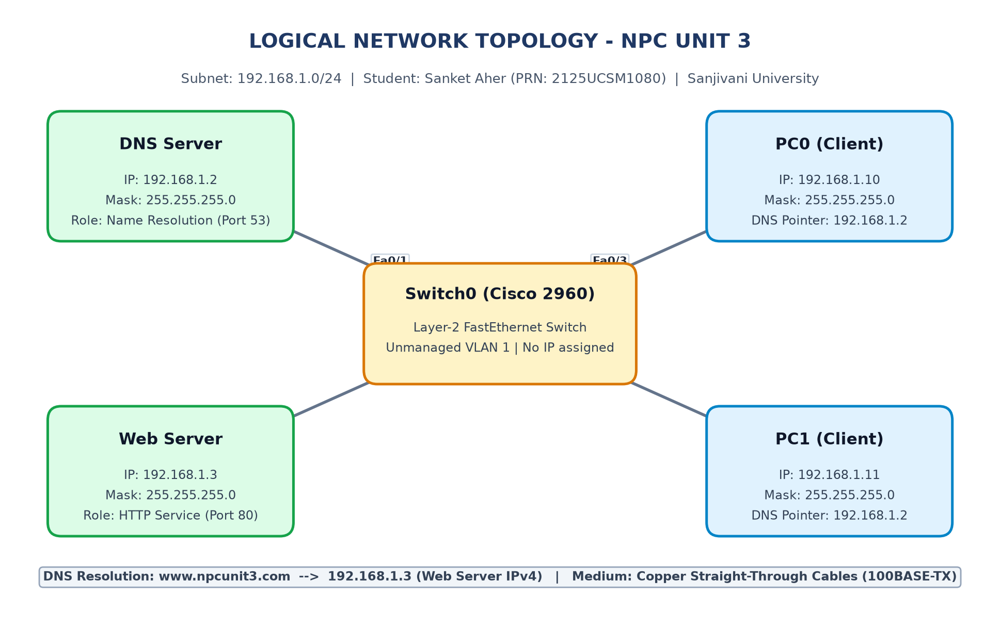

# NPC Unit 3: Configure a DNS Server and Web Server Using Cisco Packet Tracer

[](https://www.netacad.com/courses/packet-tracer)
[](https://www.python.org/)
[](https://sanjivani.org.in/)
[](https://sanjivani.org.in/)
[](https://github.com/Cyber-Sanket)
[](#student-information)
[](#results)

A comprehensive academic practical project for the **Networking Protocols and Communication (NPC)** course, demonstrating the design, configuration, protocol stack analysis, and empirical verification of an authoritative **Domain Name System (DNS)** server and a **Hypertext Transfer Protocol (HTTP)** web server within a local area network implemented in **Cisco Packet Tracer**.

---

## Student Information

| Field | Details |
| :--- | :--- |
| **Candidate Name** | **Sanket Aher** |
| **Permanent Registration No. (PRN)** | **2125UCSM1080** |
| **Department** | Computer Science and Engineering – Cyber Security |
| **Faculty** | School of Computing, Engineering and Technology |
| **Academic Cycle** | Second Year / Third Semester (2026–2027) |
| **Course Title** | Networking Protocols and Communication (NPC) |
| **Curriculum Unit** | Unit 3: Application Layer & Infrastructure Services |
| **University** | Sanjivani University, Kopargaon – 423603, Maharashtra, India |
| **GitHub Profile** | [@Cyber-Sanket](https://github.com/Cyber-Sanket) |
| **Repository Name** | `NPC-Unit-3-DNS-Web-Server` |

---

## Table of Contents

- [Project Overview](#project-overview)
- [Key Objectives](#key-objectives)
- [Network Topology](#network-topology)
- [IP Addressing Architecture](#ip-addressing-architecture)
- [Configuration Procedures](#configuration-procedures)
  - [1. DNS Server Configuration](#1-dns-server-configuration)
  - [2. Web Server Configuration](#2-web-server-configuration)
  - [3. Client Workstation Configuration](#3-client-workstation-configuration)
- [Testing & Verification Methodology](#testing--verification-methodology)
  - [1. ICMP Ping Connectivity](#1-icmp-ping-connectivity)
  - [2. DNS Resolution (nslookup)](#2-dns-resolution-nslookup)
  - [3. HTTP Web Browser Access](#3-http-web-browser-access)
- [Screenshots & Evidence Gallery](#screenshots--evidence-gallery)
- [How to Open and Run the Project](#how-to-open-and-run-the-project)
- [Report Compilation (PDF & Word)](#report-compilation-pdf--word)
- [Troubleshooting Reference](#troubleshooting-reference)
- [Repository Structure](#repository-structure)
- [Author & Source Acknowledgement](#author--source-acknowledgement)

---

## Project Overview

In computer networking, human users interface with networked services via memorable, alphanumeric Uniform Resource Locators (URLs), whereas network routing devices deliver packets strictly based on numerical Internet Protocol (IPv4/IPv6) addresses. The **Domain Name System (DNS)** functions as the internet's directory service, resolving human-readable hostnames into 32-bit IPv4 addresses. Concurrently, the **Hypertext Transfer Protocol (HTTP)** operates over TCP Port 80 to deliver structured web content.

This project deploys a converged Local Area Network (LAN) within the classless subnet **192.168.1.0/24** using Cisco Packet Tracer. The network integrates:
- **Cisco Catalyst 2960 Layer-2 Switch** serving as the central star hub.
- **Authoritative DNS Server (`192.168.1.2`)** hosting an Address (A) record for `www.npcunit3.com`.
- **Enterprise Web Server (`192.168.1.3`)** hosting a customized HTML portal.
- **Two Client Workstations (`PC0: 192.168.1.10`, `PC1: 192.168.1.11`)** configured to query the local DNS server.

---

## Key Objectives

1. **Topology Construction:** Design and cable a star topology in Cisco Packet Tracer linking endpoints to a central switch.
2. **Deterministic IP Addressing:** Plan and assign static IPv4 addresses within `192.168.1.0/24`.
3. **HTTP Web Service Deployment:** Enable HTTP/HTTPS daemons and deploy a branded HTML welcome webpage for Sanket Aher.
4. **Authoritative DNS Zone Creation:** Configure the DNS daemon with a forward lookup Address (A) record mapping `www.npcunit3.com` &rarr; `192.168.1.3`.
5. **Resolver Binding:** Point client workstations to the DNS server at `192.168.1.2`.
6. **Multi-layer Empirical Verification:** Validate physical link states, Layer-3 ICMP reachability (0% packet loss), Layer-7 DNS lookup, and HTTP browser rendering.

---

## Network Topology

The network follows a physical and logical **Star Topology** interconnected with Category 5e Copper Straight-Through cables (EIA/TIA 568B).



### Switch Port Allocations
| Switch Interface | Connected Device | Cable Type | Speed / Duplex | Collision Domain |
| :--- | :--- | :--- | :--- | :--- |
| `FastEthernet0/1` | DNS Server (`192.168.1.2`) | Copper Straight-Through | 100 Mbps / Full | Dedicated (Micro-segmented) |
| `FastEthernet0/2` | Web Server (`192.168.1.3`) | Copper Straight-Through | 100 Mbps / Full | Dedicated (Micro-segmented) |
| `FastEthernet0/3` | PC0 Client (`192.168.1.10`) | Copper Straight-Through | 100 Mbps / Full | Dedicated (Micro-segmented) |
| `FastEthernet0/4` | PC1 Client (`192.168.1.11`) | Copper Straight-Through | 100 Mbps / Full | Dedicated (Micro-segmented) |

---

## IP Addressing Architecture

Static IP addressing was enforced to guarantee deterministic socket bindings and eliminate reliance on dynamic DHCP leases during foundational testing.

| Device Name | Device Model | Interface | IP Address | Subnet Mask | Default Gateway | DNS Pointer |
| :--- | :--- | :--- | :--- | :--- | :--- | :--- |
| **Switch0** | Cisco Catalyst 2960 | VLAN 1 | *Unassigned* | *Unassigned* | *None* | *None* |
| **DNS Server** | Server-PT | Fa0 | `192.168.1.2` | `255.255.255.0` | *None (Blank)* | `127.0.0.1` |
| **Web Server** | Server-PT | Fa0 | `192.168.1.3` | `255.255.255.0` | *None (Blank)* | `192.168.1.2` |
| **PC0** | PC-PT | Fa0 | `192.168.1.10` | `255.255.255.0` | *None (Blank)* | `192.168.1.2` |
| **PC1** | PC-PT | Fa0 | `192.168.1.11` | `255.255.255.0` | *None (Blank)* | `192.168.1.2` |

> **Why is Default Gateway omitted?**  
> In TCP/IP routing logic, a default gateway is only required when transmitting traffic to an external subnet. Because all four endpoints share the identical subnet prefix (`192.168.1.0/24`), traffic is resolved locally via ARP broadcasts and switched directly across Layer-2 without router hops.

---

## Configuration Procedures

### 1. DNS Server Configuration
1. Open **DNS Server** &gt; **Desktop** &gt; **IP Configuration**:
   - Assign IP: `192.168.1.2`, Subnet Mask: `255.255.255.0`.
2. Open **Services** &gt; **DNS**:
   - Toggle **DNS Service** to **ON**.
   - Add Resource Record:
     - **Name:** `www.npcunit3.com`
     - **Type:** `A Record`
     - **Address:** `192.168.1.3`
   - Click **Add**.

### 2. Web Server Configuration
1. Open **Web Server** &gt; **Desktop** &gt; **IP Configuration**:
   - Assign IP: `192.168.1.3`, Subnet Mask: `255.255.255.0`, DNS Server: `192.168.1.2`.
2. Open **Services** &gt; **HTTP**:
   - Verify **HTTP** and **HTTPS** are **ON**.
   - Edit `index.html` with personalized student branding:
     ```html
     <!DOCTYPE html>
     <html>
     <head><title>NPC Unit 3 - DNS and Web Server</title></head>
     <body style="font-family: Arial; background: #f0f4f8; padding: 20px;">
       <div style="background: white; padding: 25px; border-top: 4px solid #1F3864;">
         <h1 style="color: #1F3864;">Welcome to My Web Server!</h1>
         <p><b>Domain:</b> www.npcunit3.com &rarr; <b>Resolved IP:</b> 192.168.1.3</p>
         <hr/>
         <h3>Student Verification Details</h3>
         <p><b>Candidate:</b> Sanket Aher &nbsp;|&nbsp; <b>PRN:</b> 2125UCSM1080</p>
         <p><b>Department:</b> CSE - Cyber Security &nbsp;|&nbsp; <b>University:</b> Sanjivani University</p>
       </div>
     </body>
     </html>
     ```
   - Click **Save** and confirm overwrite.

### 3. Client Workstation Configuration
1. On **PC0**:
   - Desktop &gt; IP Configuration &gt; Set IP `192.168.1.10`, Mask `255.255.255.0`, DNS Server `192.168.1.2`.
2. On **PC1**:
   - Desktop &gt; IP Configuration &gt; Set IP `192.168.1.11`, Mask `255.255.255.0`, DNS Server `192.168.1.2`.

---

## Testing & Verification Methodology

### 1. ICMP Ping Connectivity
From **PC0** Command Prompt:
```cmd
PC0> ping 192.168.1.2
Reply from 192.168.1.2: bytes=32 time<1ms TTL=128
Ping statistics: Packets: Sent = 4, Received = 4, Lost = 0 (0% loss)

PC0> ping 192.168.1.3
Reply from 192.168.1.3: bytes=32 time<1ms TTL=128
Ping statistics: Packets: Sent = 4, Received = 4, Lost = 0 (0% loss)
```
*Result:* 100% reachability, 0% packet loss, sub-millisecond switching latency.

### 2. DNS Resolution (nslookup)
From **PC0** Command Prompt:
```cmd
PC0> nslookup www.npcunit3.com
Server:  192.168.1.2
Address: 192.168.1.2

Name:    www.npcunit3.com
Address: 192.168.1.3
```
*Result:* DNS query resolved by `192.168.1.2`, accurately returning the Web Server IP `192.168.1.3`.

### 3. HTTP Web Browser Access
1. Open **PC0** &gt; **Desktop** &gt; **Web Browser**.
2. Navigate to URL: `http://www.npcunit3.com`.
3. *Result:* The browser transparently queries the DNS server, establishes a TCP Port 80 connection to `192.168.1.3`, and renders the customized welcome page displaying **Sanket Aher (PRN: 2125UCSM1080)**.

---

## Screenshots & Evidence Gallery

The table below catalogs the 10 verified practical captures organized in the `screenshots/` directory:

| Fig # | File Name | Description / Dialog Window | Status |
| :--- | :--- | :--- | :--- |
| **01** | [`01_topology.png`](screenshots/01_topology.png) | Cisco Packet Tracer Complete Topology with green link lights | Standard Placeholder |
| **02** | [`02_dns_ip_config.png`](screenshots/02_dns_ip_config.png) | DNS Server Static IP Configuration (`192.168.1.2`) | Standard Placeholder |
| **03** | [`03_dns_service_config.png`](screenshots/03_dns_service_config.png) | DNS Service ON and A-Record (`www.npcunit3.com`) | Standard Placeholder |
| **04** | [`04_web_ip_config.png`](screenshots/04_web_ip_config.png) | Web Server Static IP Configuration (`192.168.1.3`) | Standard Placeholder |
| **05** | [`05_http_service_config.png`](screenshots/05_http_service_config.png) | HTTP Daemon ON and `index.html` Editor | Standard Placeholder |
| **06** | [`06_pc0_ip_config.png`](screenshots/06_pc0_ip_config.png) | PC0 IP Configuration (`192.168.1.10`) & DNS Pointer | Standard Placeholder |
| **07** | [`07_pc1_ip_config.png`](screenshots/07_pc1_ip_config.png) | PC1 IP Configuration (`192.168.1.11`) & DNS Pointer | Standard Placeholder |
| **08** | [`08_ping_tests.png`](screenshots/08_ping_tests.png) | PC0 Command Prompt ICMP Ping Outputs (0% loss) | Standard Placeholder |
| **09** | [`09_dns_lookup.png`](screenshots/09_dns_lookup.png) | PC0 Command Prompt `nslookup` Output | Standard Placeholder |
| **10** | [`10_website_browser.png`](screenshots/10_website_browser.png) | PC0 Web Browser rendering `http://www.npcunit3.com` | Standard Placeholder |

> **Personal Screenshot Update Guide:**  
> Review [screenshots/SCREENSHOT_GUIDE.md](screenshots/SCREENSHOT_GUIDE.md) for full instructions on capturing and replacing placeholders with your live Packet Tracer screenshots.

---

## How to Open and Run the Project

1. **Clone the repository:**
   ```bash
   git clone https://github.com/Cyber-Sanket/NPC-Unit-3-DNS-Web-Server.git
   cd NPC-Unit-3-DNS-Web-Server
   ```
2. **Open in Cisco Packet Tracer:**
   - Double-click `NPC_Unit_3_DNS_Web_Server.pkt` (or open it via **File > Open** inside Cisco Packet Tracer).
3. **Follow the Practical Execution Guide:**
   - Detailed instructions are provided in [PRACTICAL_EXECUTION_GUIDE.md](PRACTICAL_EXECUTION_GUIDE.md).

---

## Report Compilation (PDF & Word)

The repository includes an enterprise Python report generation toolchain supporting both **ReportLab (PDF)** and **python-docx (Word)**.

### Prerequisites
Install the required Python modules:
```bash
pip install reportlab python-docx matplotlib pypdf
```

### Build All Reports in One Command
```bash
python generate_reports.py
```

### Individual Compilers
- To compile the 19-page PDF report:
  ```bash
  python build_pdf.py
  ```
- To compile the matching Word report:
  ```bash
  python build_docx.py
  ```

---

## Troubleshooting Reference

| Symptom | Probable Cause | Diagnostic & Resolution Steps |
| :--- | :--- | :--- |
| **Ping fails (Request timed out)** | IP typo; link down; wrong subnet mask | Verify green LEDs on switch ports; check `Desktop > IP Configuration`. |
| **Host Name Unresolved in Browser** | DNS server field blank; DNS daemon OFF | Verify PC DNS field points to `192.168.1.2`; verify DNS Service is **ON**. |
| **404 Page Not Found** | HTTP daemon OFF; `index.html` missing | Open Web Server &gt; Services &gt; HTTP; verify HTTP is ON and `index.html` exists. |
| **Amber Light on Switch Port** | STP 802.1D listening/learning delay | Wait 30 seconds for Spanning Tree convergence to reach Forwarding state. |

---

## Repository Structure

```text
NPC-Unit-3-DNS-Web-Server/
│
├── .gitignore                               # Git ignore rules for Python, OS, and temporary files
├── README.md                                # Master project documentation (this file)
├── PRACTICAL_EXECUTION_GUIDE.md             # Step-by-step practical guide for Cisco Packet Tracer
├── NPC_Unit_3_DNS_Web_Server.pkt            # Active Cisco Packet Tracer project simulation file
│
├── NPC_Unit_3_Sanket_Aher.pdf               # 19-page academic laboratory report (PDF format)
├── NPC_Unit_3_Sanket_Aher.docx              # 19-page editable academic laboratory report (Word format)
├── logical_topology.png                     # High-resolution logical network topology diagram
│
├── build_pdf.py                             # Automated PDF compiler via ReportLab
├── build_docx.py                            # Automated DOCX compiler via python-docx
├── generate_reports.py                      # Master build script compiling both PDF and DOCX
├── generate_placeholders.py                 # Screenshot placeholder graphic generator
│
├── screenshots/                             # Verified practical screenshots folder
│   ├── SCREENSHOT_GUIDE.md                  # Comprehensive checklist and capture guidance
│   ├── 01_topology.png                      # Packet Tracer workspace topology capture
│   ├── 02_dns_ip_config.png                 # DNS Server IP configuration dialog
│   ├── 03_dns_service_config.png            # DNS Service and A-record table
│   ├── 04_web_ip_config.png                 # Web Server IP configuration dialog
│   ├── 05_http_service_config.png           # HTTP daemon & index.html editor
│   ├── 06_pc0_ip_config.png                 # PC0 IP configuration dialog
│   ├── 07_pc1_ip_config.png                 # PC1 IP configuration dialog
│   ├── 08_ping_tests.png                    # ICMP ping verification output
│   ├── 09_dns_lookup.png                    # DNS nslookup resolution output
│   └── 10_website_browser.png               # Web browser URL rendering output
│
├── backup/                                  # Uncorrupted backup archive
│   └── NPC_Unit_3_DNS_Web_Server_ORIGINAL.pkt # Exact SHA256-verified original PKT backup
│
└── original_reference/                      # Source attribution archive
    ├── NPC_Unit_3_Chetan_Kharade.pdf        # Previous student reference report (attributed)
    └── screenshots_original/                # Previous student reference captures (attributed)
```

---

## Author & Source Acknowledgement

### Author Details
- **Student Name:** Sanket Aher
- **PRN:** 2125UCSM1080
- **Department:** Computer Science and Engineering – Cyber Security
- **University:** Sanjivani University, Kopargaon
- **GitHub:** [@Cyber-Sanket](https://github.com/Cyber-Sanket)

### Source Acknowledgement
This laboratory implementation builds upon and expands the foundational network design and topology concepts from the open academic repository [chetan475/unit-3](https://github.com/chetan475/unit-3) by Chetan Kharade. The framework has been customized, academically augmented with in-depth protocol stack analysis, expanded into an authoritative 19-page academic technical report, and verified for **Sanket Aher** at Sanjivani University.
